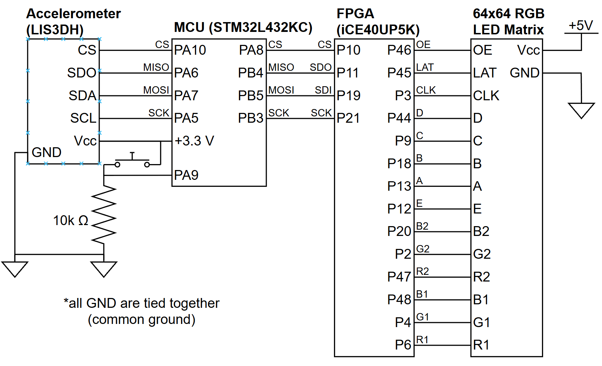
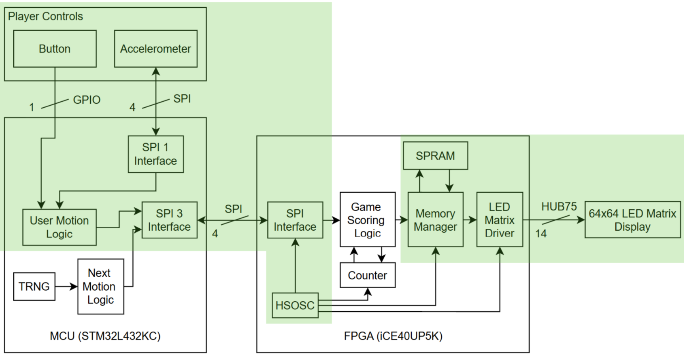
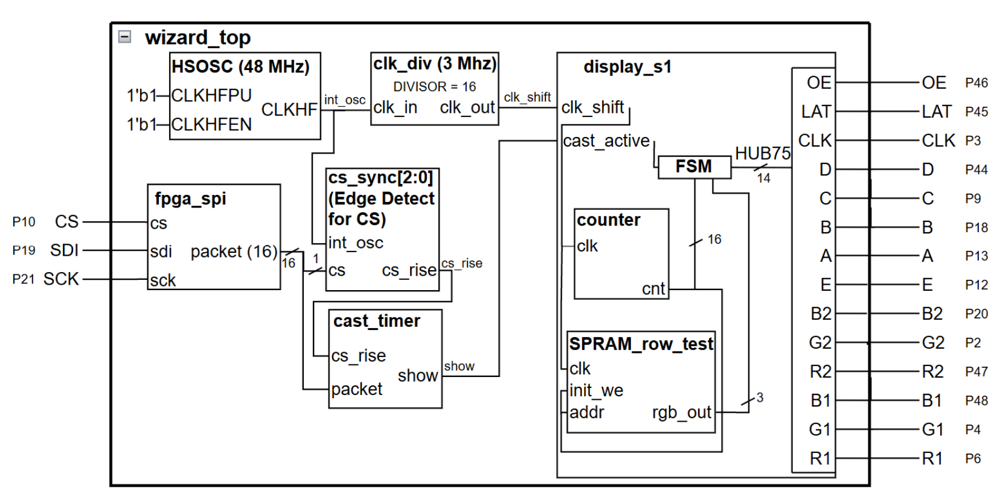

---
title: "Midpoint Checkoff"
description: "Accelerometer, SPI communication and SPRAM initial draft"
author: "Jessica Li & Ellen Yu"
date: "11/17/26"
categories:
  - reflection
  - progress report
draft: false
--- 

## Midpoint for Wizard Project

Our project for E155 is a gesture-based spell-casting game in which the player waves a handheld wand (STM32L432KC MCU + LIS3DH accelerometer + push-button) to match directional prompts displayed on a 64×64 RGB LED matrix driven by an iCE40UP5K FPGA.

## Current Status

::: {.callout-note collapse="true"}
## Schematic

{#fig-schematic}

Midpoint schematic, full-system connections from the accelerometer to MCU to FPGA to RGB LED matrix.
:::

::: {.callout-note collapse="false"}
## System-level Block Diagram

{#fig-sys_block}

High-level system block diagram for the project. Green highlights indicate subsystems derisked by the project midpoint (player controls, MCU motion detection, MCU to FPGA SPI link, internal HSOSC clock, basic LED matrix driving, preliminary memory manager for SPRAM access), and the unshaded blocks represent remaining gameplay logic.
:::

1. **Player Input & Gesture Detection:** Button polling and LIS3DH accelerometer gesture recognition on the MCU.

2. **All Communication Protocol Interfaces:** Gesture detection from the LIS3DH accelerometer successfully triggers visual updates on the 64×64 RGB LED matrix, verifying end-to-end operation across (MCU to accelerometer), SPI 3 (MCU to FPGA), and basic HUB75 driving (FPGA to LED matrix)

3. **Preliminary SPRAM Interface:** An initial SystemVerilog module verifying read/write access to the iCE40UP5K’s on-chip SP256K memory block.

Remaining work for the final milestone includes implementing the MCU's TRNG-based spell prompt generator, building the FPGA game-scoring FSM and countdown timer, and expanding the SPRAM memory manager to store and render directional arrows and life/score graphics. 

### MCU Outline

1. **Initialization** (`initSPI`, `initAccel`, `accelSetRange`): Configures SPI1 (for accelerometer communication) and SPI3 (for FPGA communication), enables accelerometer 100 Hz 12-bit high-resolution sampling, and sets full-scale range to 8g.

2. **Sensor Acquisition (SPI)** (`accelDataReady`, `accelReadRaw`, `accelReadMg`): Polls `STATUS_REG`, and once ready it reads the 6 output registers, and converts the raw 12-bit values to milli-g (mg).

3. **Gesture Detection & Transmission** (main loop): Polls the wand button, checks `accelReadMg` against x,y, x directional thresholds to record the first valid axis crossing. If the threshold exceeded is in the +x direction, it sends a 16-bit packet (0x0001 for +x) over SPI3 to the FPGA. For the debugging process, this signal causes the FPGA to light an LED to confirm successful communication. The SPI3 communication line will support all directions by project finish.

### FPGA Overview

::: {.callout-note collapse="false"}
## FPGA Block Diagram

{#fig-lock}

:::

## Part Orders and BOM

| Item | Quantity | Price | Part number | notes |
| :--- | :---: | :---: | :--- | :--- |
| [64x64 RGB LED Matrix](https://www.amazon.com/dp/B0F31TZY6Q?lv=shuf&channelId=500&plpRedirect=mhFallback) | 1 | 42.89 | RGB-Matrix-P3.0-64x64 | |
| [Accelerometer](https://pages.hmc.edu/harris/class/e85/LIS3DH.pdf) | 1 | NA | LIS3DH | HMC stockroom |
: Bill of Materials

All parts have arrived.
